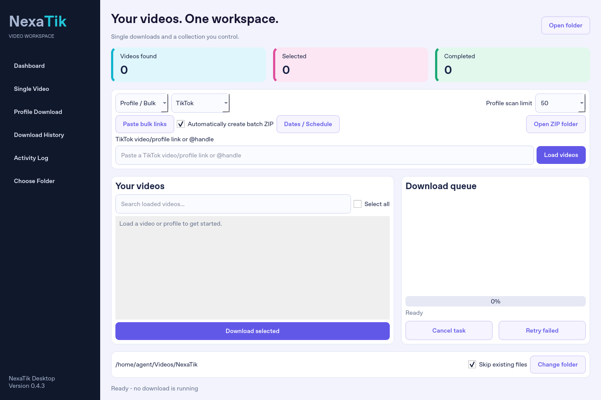

# Nexa Software

Windows desktop tools, downloads and practical product guides.

**[Visit the live website](https://nexa-software-downloads.pages.dev/)** · **[Download NexaTik 0.5.2 for Windows](https://github.com/ibrahimhashimaa007-bit/nexatik-updates/releases/download/v0.5.2/NexaTik-Setup-0.5.2.exe)** · **[All NexaTik releases](https://github.com/ibrahimhashimaa007-bit/nexatik-updates/releases)**



## NexaTik for Windows

NexaTik brings single-video links and bulk video workflows into one desktop workspace.

- Select YouTube, Facebook, Instagram or TikTok.
- Load supported video links or available profile lists and choose items for a batch.
- Save video titles and descriptions alongside completed videos.
- Filter by upload date and schedule a batch while the app stays open.
- Automatically create a ZIP of a completed batch.
- View history, skip existing files, cancel work and retry failed items.

Availability depends on the platform, content, login and verification requirements. Complete profile coverage and successful downloads from every URL are not guaranteed. Only download content you own or are authorized to save, where the platform permits it.

The current 0.5.2 release is free. Download the complete Windows installer from the release link above.

## Explore the website

| Page | Link |
| --- | --- |
| NexaTik | https://nexa-software-downloads.pages.dev/nexatik/ |
| Download center | https://nexa-software-downloads.pages.dev/downloads/ |
| Installation and help | https://nexa-software-downloads.pages.dev/guides/ |
| NexaRemote preview | https://nexa-software-downloads.pages.dev/nexaremote/ |
| NexaConnect preview | https://nexa-software-downloads.pages.dev/nexaconnect/ |

NexaRemote and NexaConnect are previews. Tested public installers are not listed for these products yet.

## Website source

This repository contains the complete static website and its page generator. Desktop application releases are distributed through [nexatik-updates](https://github.com/ibrahimhashimaa007-bit/nexatik-updates).

| Location | Purpose |
| --- | --- |
| `dist/` | Ready-to-deploy HTML, shared CSS/JavaScript, images, sitemap and robots.txt |
| `build.py` | Generates the HTML pages and search/share metadata using Python 3 |
| `source-assets/` | Source interface image |
| `verification/` | Google ownership verification file preserved during builds |
| `Prepare-Website.ps1` | Updates the public URL and creates the Cloudflare upload ZIP |
| `docs/OWNER-GUIDE-Roman-Urdu.md` | Editing and deployment instructions |

## Edit and publish

For page content changes, edit `build.py` and run `python build.py`. Edit shared styles and interactions directly in `dist/assets/style.css` and `dist/assets/app.js`. The generator preserves those two files.

For a local preview, run `python -m http.server 8080 --bind 127.0.0.1 --directory dist`, then open http://127.0.0.1:8080/.

On Windows, run `Prepare-Website.ps1` to create `Nexa-Software-Pages-Upload.zip`. In Cloudflare, select **Workers & Pages → nexa-software-downloads → Create deployment → Production**, then upload that generated ZIP.

The existing Cloudflare project uses Direct Upload. A GitHub commit alone does not deploy this project; publish the updated files through Cloudflare after editing. Keep the existing production site address when rebuilding.

## Installer integrity

NexaTik 0.5.2 installer SHA-256:

```text
a0bd3dad07ec5ea7d64efd66c17bc9a608584c6cffdf50028957f8bedad4950a
```

See the website [privacy](https://nexa-software-downloads.pages.dev/privacy/) and [use information](https://nexa-software-downloads.pages.dev/terms/) pages for the current product and download scope.
